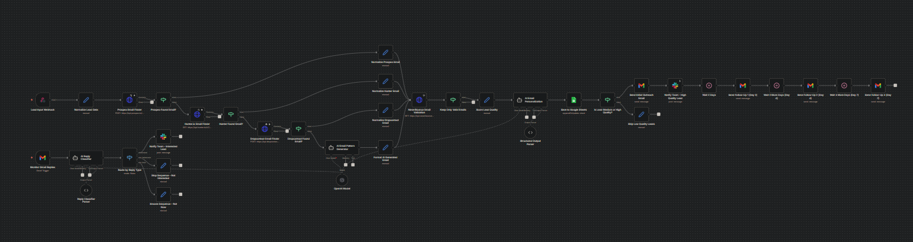

# 🚀 AI GTM / Sales Automation Engine (n8n Workflow)

This project is a fully automated **AI-powered outbound sales system** built in n8n.  
It handles lead generation, email discovery, validation, AI personalization, outreach sequencing, and reply classification — all end-to-end without manual work.

---

## 🧠 What this system does

This workflow automates the entire outbound pipeline:

- 📥 Lead intake via webhook
- 🔎 Email discovery using multiple providers (Prospeo, Hunter.io, Dropcontact)
- 🤖 AI-generated email guessing (fallback)
- ✅ Email validation (NeverBounce)
- 🧹 Data normalization & enrichment
- 📊 Lead scoring (low / medium / high)
- ✍️ AI-personalized cold email generation
- 📤 Automated email sending (Gmail)
- 🔁 Multi-step follow-up sequence (Day 2 → Day 4 → Day 7)
- 📈 Google Sheets CRM logging
- 🔔 Slack notifications for high-value leads
- 💬 AI reply classification (interested / not_interested / not_now)
- 🧠 Automated reply handling (stop / snooze / notify)

---

## 🖼️ System Overview

---

## ⚙️ Tech Stack

- **n8n** (workflow automation engine)
- **OpenAI GPT-4o-mini** (email generation + classification)
- **Prospeo / Hunter.io / Dropcontact** (email enrichment)
- **NeverBounce API** (email validation)
- **Gmail API** (sending + monitoring replies)
- **Google Sheets** (CRM storage)
- **Slack API** (notifications)

---

## 🧩 Workflow Architecture

### 1. Lead Intake
Incoming leads are received via a webhook and normalized.

### 2. Email Discovery Chain
The system tries multiple providers in order:
- Prospeo
- Hunter.io
- Dropcontact
- AI-generated pattern fallback

### 3. Validation Layer
All emails are verified using NeverBounce before outreach.

### 4. Lead Scoring
Leads are categorized based on confidence:
- High (≥85)
- Medium (70–84)
- Low (<70)

### 5. AI Email Generation
GPT generates:
- Subject line
- Personalized first line
- Full email body

### 6. Outreach Engine
If lead is valid:
- Initial email is sent
- Follow-up emails are scheduled automatically

### 7. Reply Intelligence
Replies are monitored and classified:
- Interested → Slack notification
- Not interested → stop sequence
- Not now → snooze and retry later

---

## 📊 Output

The system produces:

- Qualified leads database
- Automated email campaigns
- Reply classification logs
- Real-time Slack alerts
- Engagement tracking

---

## 💡 Why this matters

This system replaces a full **Sales Development Rep (SDR) workflow** with automation:

> Instead of manual prospecting, writing, and following up — everything runs autonomously.

---

## 🚀 Future Improvements

- Add CRM integration (HubSpot / Salesforce)
- Add analytics dashboard (reply rate, conversion rate)
- Add multi-channel outreach (LinkedIn + email)
- Add AI optimization loop (A/B testing emails)

---

## 🧑‍💻 Author

Built as an AI automation / GTM engineering project showcasing:
- workflow automation
- AI agents
- revenue systems design